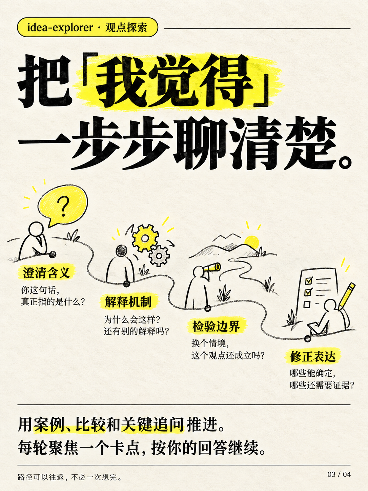

# idea-explorer · 观点探索

> 让 AI 陪你思考，也敢指出你想错了。

陪用户逐步探索尚未成熟的观点、直觉或疑问——通过澄清含义、案例比较、机制分析和边界检验，深化理解并修正误解。

## 它做什么

- **接住直觉**：接住还没整理清楚的念头，帮你弄清自己真正想说什么
- **澄清含义**：辨认关键词，区分描述、因果判断、价值判断与个人体验
- **拆开逻辑**：指出关键前提、推理连接和隐含条件
- **解释机制**：说明可能怎样发生，给有解释力的替代解释
- **检验边界**：比较相似情境、寻找反例、改变关键条件，检查观点在什么范围成立
- **暂时收束**：给出更准确的表述、修正的理由、仍未解决的问题

原则：**有依据地质疑，不为反对而反对**。表达清楚、理解加深、修正观点、找到更好的问题，都算成功；不以让用户坚定原观点或同意 AI 为目标。

## 什么时候用

| 适合 | 不适合 |
|------|--------|
| 「我隐约觉得，但说不清」 | 单纯事实问答 |
| 「帮我深入理解这个想法」 | 成稿写作 |
| 想检验一个观点哪里站不住 | 要求完整研究报告 |

## 安装

把本仓库放入你所用 Agent 的 skills 目录（WorkBuddy 为例）：

```bash
git clone https://github.com/hei5417-ux/idea-explorer.git ~/.workbuddy/skills/idea-explorer
```

## 使用

在对话中触发：

```text
使用 $idea-explorer，我有个不成熟的想法：……
```

## 推广海报

<div align="center">
  
  
  
</div>
<div align="center">
  
  
  
</div>
<div align="center">
  
  
  
</div>

## 目录结构

```text
idea-explorer/
├── SKILL.md               # 主定义
├── agents/openai.yaml     # 接口配置
├── references/            # 对话示例
└── assets/                # 推广海报
```
